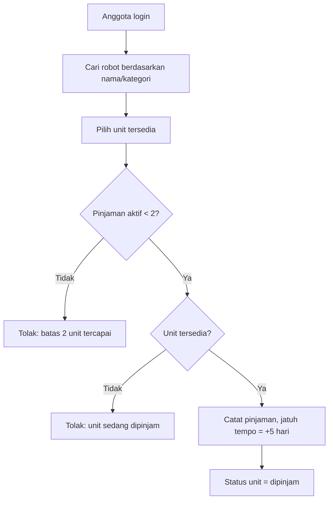
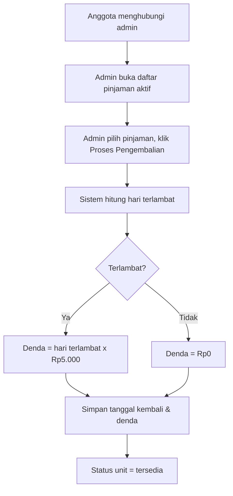

# Business Requirements Document (BRD)

## Sistem Peminjaman Robot Pacar

| | |
|---|---|
| **Nama Project** | Sistem Peminjaman Robot Pacar |
| **Nama Kelompok** | RoPar|
| **Versi** | 1.0 |
| **Tanggal** | 22 Oktober 2026 |

---

## 1. Latar Belakang

RoPar (Robot Pacar) adalah aplikasi web untuk mengelola layanan peminjaman robot secara terpusat. Anggota dapat mendaftar, mencari robot dan unit yang tersedia, melakukan peminjaman, serta melihat status dan riwayat pinjaman. Admin mengelola data robot, kategori, unit, dan anggota, memproses pengembalian, menghitung denda keterlambatan, serta mencetak laporan. Sistem membantu menjaga data ketersediaan unit dan transaksi peminjaman tetap tercatat dengan konsisten.

## 2. Tujuan Bisnis

1. Menyediakan platform web bagi anggota untuk mencari dan meminjam robot secara mandiri.
2. Memberi admin kontrol penuh atas data robot, kategori, anggota, dan proses pengembalian.
3. Menegakkan aturan peminjaman (maksimal 2 unit, maksimal 5 hari) secara otomatis.
4. Menghitung denda keterlambatan otomatis dan akurat.
5. Menyediakan riwayat peminjaman yang dapat dicetak sebagai laporan.

## 3. Ruang Lingkup

### 3.1 Dalam Lingkup
- Autentikasi (registrasi anggota, login, logout).
- Manajemen profil anggota (satu user satu profil).
- Manajemen data robot, unit robot, kategori, dan anggota oleh admin (CRUD).
- Pencarian robot berdasarkan nama atau kategori.
- Peminjaman unit oleh anggota.
- Pengembalian unit oleh admin dengan perhitungan denda otomatis.
- Daftar pinjaman aktif (admin: semua; anggota: milik sendiri).
- Riwayat peminjaman dan cetak laporan (admin).

### 3.2 Di Luar Lingkup
- Pembayaran denda online (denda hanya dicatat dan dikonfirmasi admin).
- Notifikasi email/WhatsApp.
- Aplikasi mobile native.
- Reservasi/antrean untuk unit yang sedang dipinjam.

## 4. Pemangku Kepentingan

| Pemangku Kepentingan | Peran | Kepentingan |
|---|---|---|
| Admin | Pengelola layanan | Mengelola data, memproses pengembalian, melihat laporan |
| Anggota | Peminjam | Mencari dan meminjam robot, melihat pinjaman sendiri |

## 5. Aktor / Jenis Pengguna

| Aktor | Deskripsi |
|---|---|
| **Admin** | Dibuat melalui seeder. Mengelola seluruh data dan proses pengembalian. |
| **Anggota** | Mendaftar sendiri melalui halaman registrasi. Hanya anggota terdaftar yang dapat meminjam. |

## 6. Aturan Bisnis

| ID | Aturan |
|---|---|
| BR-01 | Semua pengguna wajib login untuk mengakses web (kecuali halaman login dan registrasi). |
| BR-02 | Hanya anggota terdaftar yang dapat meminjam unit. |
| BR-03 | Satu user hanya memiliki satu profil. |
| BR-04 | Setiap user hanya dapat mengubah profilnya sendiri. |
| BR-05 | Satu robot dapat memiliki lebih dari satu kategori. |
| BR-06 | Satu nama robot dapat memiliki banyak unit, dibedakan oleh kode unit. |
| BR-07 | Kode unit harus unik di seluruh sistem. |
| BR-08 | Seorang anggota maksimal meminjam **2 unit** secara bersamaan. |
| BR-09 | Durasi pinjaman maksimal **5 hari**. |
| BR-10 | Keterlambatan dikenai denda **Rp5.000 per hari** keterlambatan. |
| BR-11 | Pengembalian hanya dapat diproses oleh admin; anggota menghubungi admin untuk mengembalikan unit. |
| BR-12 | Denda dihitung otomatis oleh sistem saat admin memproses pengembalian. |
| BR-13 | Hanya admin yang dapat menambah, mengubah, dan menghapus data robot, unit, kategori, dan anggota. |
| BR-14 | Anggota hanya dapat melihat pinjaman miliknya; admin dapat melihat semua pinjaman. |
| BR-15 | Unit yang sedang dipinjam tidak dapat dipinjam anggota lain. |
| BR-16 | Data yang masih memiliki pinjaman aktif tidak boleh dihapus. |

### Rumus Denda

```
jatuh_tempo        = tanggal_pinjam + 5 hari
hari_terlambat     = max(0, tanggal_kembali - jatuh_tempo)   (dalam hari)
denda              = hari_terlambat x Rp5.000
```

Contoh: dipinjam 1 Nov, jatuh tempo 6 Nov, dikembalikan 9 Nov → terlambat 3 hari → denda Rp15.000.

## 7. Kebutuhan Bisnis

| ID | Kebutuhan | Prioritas |
|---|---|---|
| BRQ-01 | Anggota dapat mendaftar dan login | Tinggi |
| BRQ-02 | Anggota dapat mencari robot berdasarkan nama atau kategori | Tinggi |
| BRQ-03 | Anggota dapat meminjam unit sesuai batas aturan | Tinggi |
| BRQ-04 | Anggota dapat melihat daftar pinjaman miliknya | Tinggi |
| BRQ-05 | Anggota dapat melihat dan mengubah profil sendiri | Sedang |
| BRQ-06 | Admin dapat CRUD robot, unit, kategori, dan anggota | Tinggi |
| BRQ-07 | Admin dapat memproses pengembalian dengan denda otomatis | Tinggi |
| BRQ-08 | Admin dapat melihat daftar unit yang sedang dipinjam | Tinggi |
| BRQ-09 | Admin dapat melihat dan mencetak riwayat peminjaman | Sedang |

## 8. Alur Proses Bisnis

### 8.1 Peminjaman



### 8.2 Pengembalian



## 9. Asumsi dan Batasan

- Sistem berbasis web dan diakses melalui browser.
- Admin awal dibuat lewat seeder; tidak ada registrasi admin dari UI.
- Denda dicatat di sistem; pembayaran dilakukan di luar sistem.
- Satu transaksi peminjaman mencakup satu unit; meminjam dua robot berarti dua transaksi.
- Hitungan hari menggunakan selisih tanggal kalender (jam diabaikan).
- Hari pinjam dan hari kembali tidak dihitung terpisah: pinjam 1 Nov dan kembali 6 Nov masih tepat waktu.

## 10. Kriteria Keberhasilan

- Seluruh 9 kebutuhan bisnis berjalan sesuai aturan bisnis.
- Tidak ada anggota yang dapat memiliki lebih dari 2 pinjaman aktif.
- Denda terhitung benar pada seluruh skenario uji (UAT).
- Admin dapat mencetak riwayat peminjaman.
- Seluruh dokumen dan kode terdorong ke GitLab.

## 11. Risiko

| Risiko | Dampak | Mitigasi |
|---|---|---|
| Dua anggota meminjam unit yang sama bersamaan | Data ganda | Transaksi database dan pengecekan status unit |
| Kesalahan hitung denda | Sengketa | Logika terpusat di satu service dan unit test |
| Penghapusan data yang masih dipakai | Data rusak | Foreign key `restrict` dan validasi sebelum hapus |
