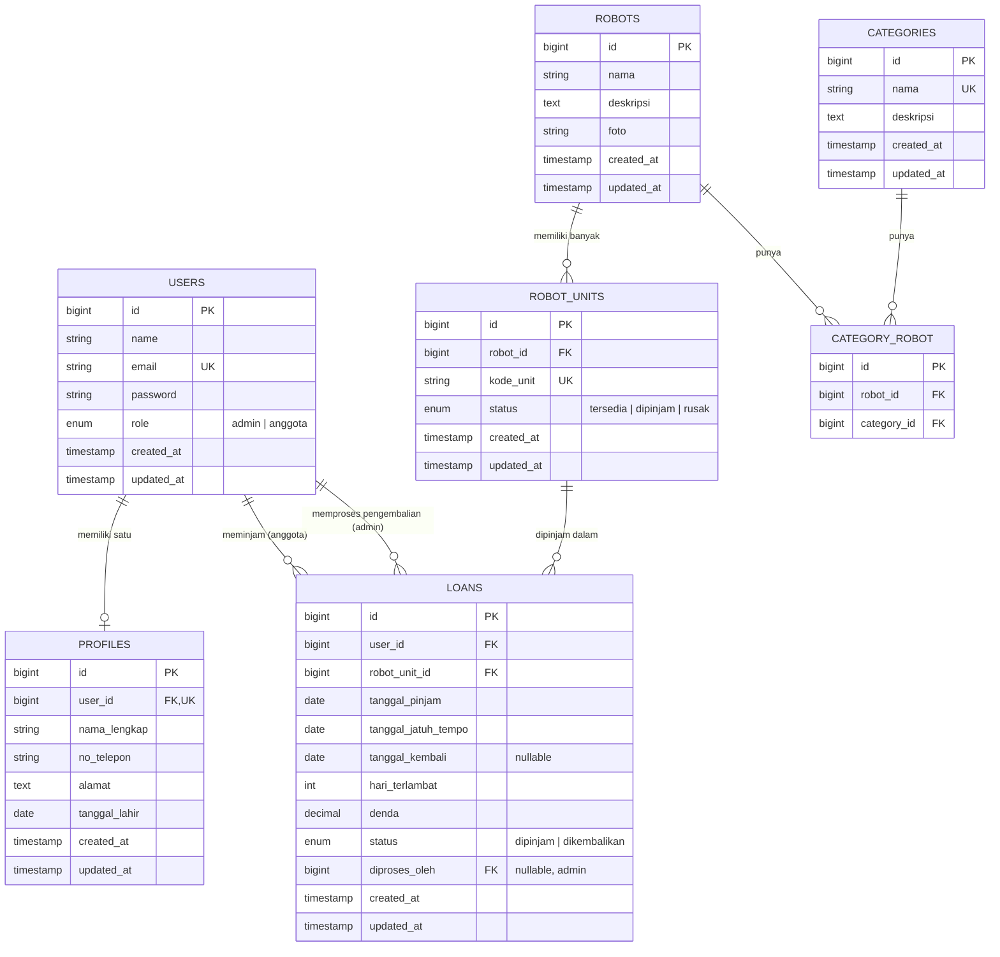

# Entity Relationship Diagram (ERD)

## Sistem Peminjaman Robot Pacar

## 1. Diagram



## 2. Kamus Data

### 2.1 `users`

| Kolom | Tipe | Constraint | Keterangan |
|---|---|---|---|
| id | bigint | PK, auto increment | |
| name | varchar(100) | NOT NULL | Nama akun |
| email | varchar(150) | NOT NULL, UNIQUE | Untuk login |
| password | varchar(255) | NOT NULL | Hash bcrypt |
| role | enum('admin','anggota') | NOT NULL, default 'anggota' | Jenis pengguna |
| created_at, updated_at | timestamp | | |

### 2.2 `profiles`

| Kolom | Tipe | Constraint | Keterangan |
|---|---|---|---|
| id | bigint | PK | |
| user_id | bigint | FK → users.id, **UNIQUE**, ON DELETE CASCADE | Menjamin satu user satu profil |
| nama_lengkap | varchar(150) | NOT NULL | |
| no_telepon | varchar(20) | NOT NULL | |
| alamat | text | NOT NULL | |
| tanggal_lahir | date | NULL | |
| created_at, updated_at | timestamp | | |

### 2.3 `categories`

| Kolom | Tipe | Constraint | Keterangan |
|---|---|---|---|
| id | bigint | PK | |
| nama | varchar(100) | NOT NULL, UNIQUE | |
| deskripsi | text | NULL | |

### 2.4 `robots`

| Kolom | Tipe | Constraint | Keterangan |
|---|---|---|---|
| id | bigint | PK | |
| nama | varchar(150) | NOT NULL | Nama model robot (boleh punya banyak unit) |
| deskripsi | text | NULL | |
| foto | varchar(255) | NULL | Path gambar |

### 2.5 `category_robot` (pivot, many-to-many)

| Kolom | Tipe | Constraint | Keterangan |
|---|---|---|---|
| id | bigint | PK | |
| robot_id | bigint | FK → robots.id, ON DELETE CASCADE | |
| category_id | bigint | FK → categories.id, ON DELETE RESTRICT | |
| | | UNIQUE (robot_id, category_id) | Tidak ada kategori ganda per robot |

### 2.6 `robot_units`

| Kolom | Tipe | Constraint | Keterangan |
|---|---|---|---|
| id | bigint | PK | |
| robot_id | bigint | FK → robots.id, ON DELETE RESTRICT | |
| kode_unit | varchar(50) | NOT NULL, **UNIQUE** | Contoh: `RBT-AYA-001` |
| status | enum('tersedia','dipinjam','rusak') | NOT NULL, default 'tersedia' | |

### 2.7 `loans`

| Kolom | Tipe | Constraint | Keterangan |
|---|---|---|---|
| id | bigint | PK | |
| user_id | bigint | FK → users.id, ON DELETE RESTRICT | Peminjam |
| robot_unit_id | bigint | FK → robot_units.id, ON DELETE RESTRICT | |
| tanggal_pinjam | date | NOT NULL | |
| tanggal_jatuh_tempo | date | NOT NULL | tanggal_pinjam + 5 hari |
| tanggal_kembali | date | NULL | Terisi saat admin memproses pengembalian |
| hari_terlambat | int | NOT NULL, default 0 | |
| denda | decimal(10,2) | NOT NULL, default 0 | hari_terlambat × 5000 |
| status | enum('dipinjam','dikembalikan') | NOT NULL, default 'dipinjam' | |
| diproses_oleh | bigint | FK → users.id, NULL | Admin yang memproses pengembalian |

## 3. Relasi

| Relasi | Kardinalitas | Penjelasan |
|---|---|---|
| users – profiles | 1 : 0..1 | Satu user maksimal satu profil (UNIQUE `user_id`) |
| users – loans (peminjam) | 1 : N | Anggota dapat punya banyak riwayat pinjaman |
| users – loans (diproses_oleh) | 1 : N | Admin dapat memproses banyak pengembalian |
| robots – robot_units | 1 : N | Satu nama robot memiliki banyak unit |
| robots – categories | M : N | Lewat `category_robot` |
| robot_units – loans | 1 : N | Satu unit dipinjam berkali-kali pada waktu berbeda |

## 4. Aturan Integritas dan Constraint Logika

| Aturan | Penegakan |
|---|---|
| Kode unit tidak boleh sama | UNIQUE index `robot_units.kode_unit` |
| Satu user satu profil | UNIQUE index `profiles.user_id` |
| Maksimal 2 pinjaman aktif per anggota | Validasi aplikasi: `COUNT(loans WHERE user_id = ? AND status = 'dipinjam') < 2` |
| Unit tidak dapat dipinjam ganda | Cek `robot_units.status = 'tersedia'` di dalam DB transaction (dengan `lockForUpdate`) |
| Data yang dipakai tidak boleh dihapus | Foreign key `RESTRICT` pada `loans`, `robot_units`, dan `category_robot.category_id` |
| Hanya anggota yang dapat meminjam | Validasi `users.role = 'anggota'` |

## 5. Contoh Query Penting

**Pinjaman aktif milik anggota**
```sql
SELECT l.*, ru.kode_unit, r.nama
FROM loans l
JOIN robot_units ru ON ru.id = l.robot_unit_id
JOIN robots r ON r.id = ru.robot_id
WHERE l.user_id = :user_id AND l.status = 'dipinjam';
```

**Pencarian robot berdasarkan nama atau kategori**
```sql
SELECT DISTINCT r.*
FROM robots r
LEFT JOIN category_robot cr ON cr.robot_id = r.id
LEFT JOIN categories c ON c.id = cr.category_id
WHERE r.nama LIKE :kata OR c.nama LIKE :kata;
```

**Hitung denda saat pengembalian**
```sql
UPDATE loans
SET tanggal_kembali = CURRENT_DATE,
    hari_terlambat  = GREATEST(0, DATEDIFF(CURRENT_DATE, tanggal_jatuh_tempo)),
    denda           = GREATEST(0, DATEDIFF(CURRENT_DATE, tanggal_jatuh_tempo)) * 5000,
    status          = 'dikembalikan',
    diproses_oleh   = :admin_id
WHERE id = :loan_id;
```
