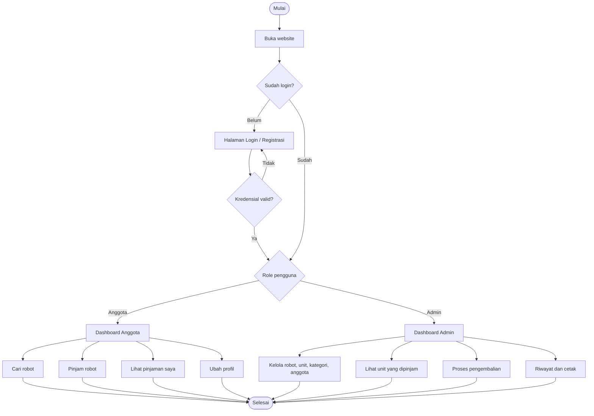
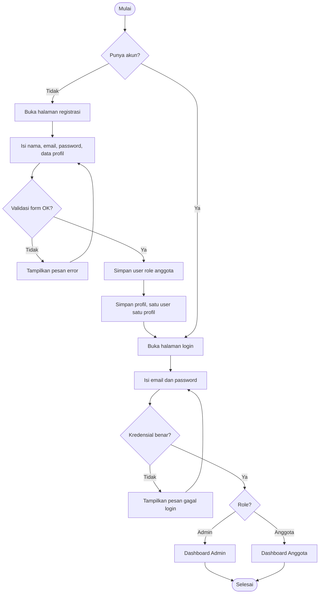
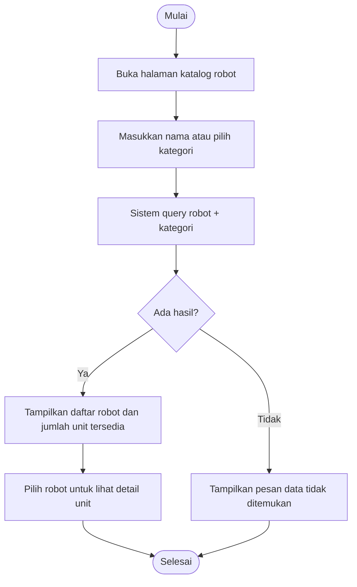
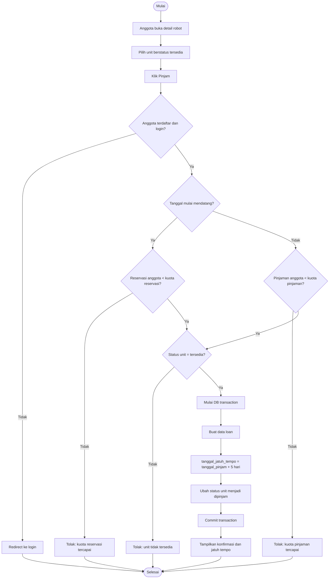
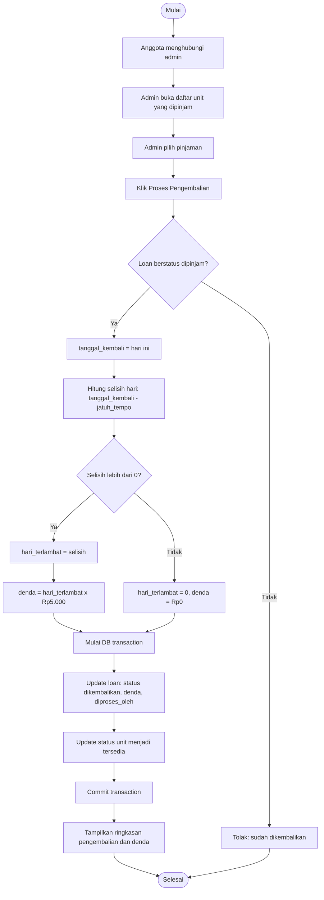
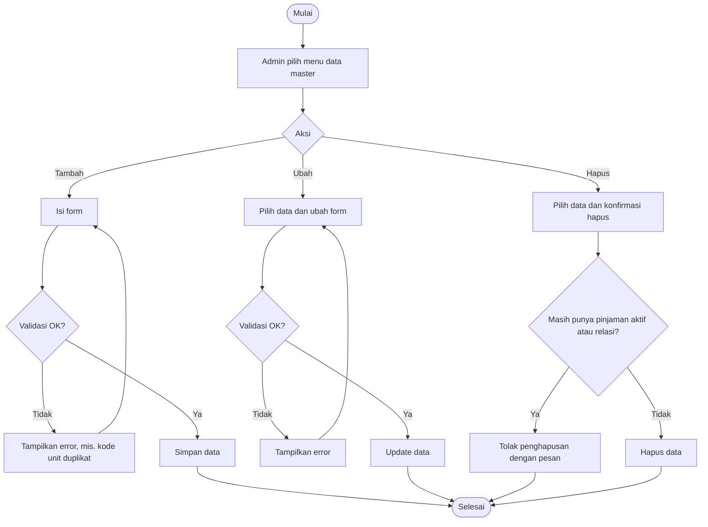
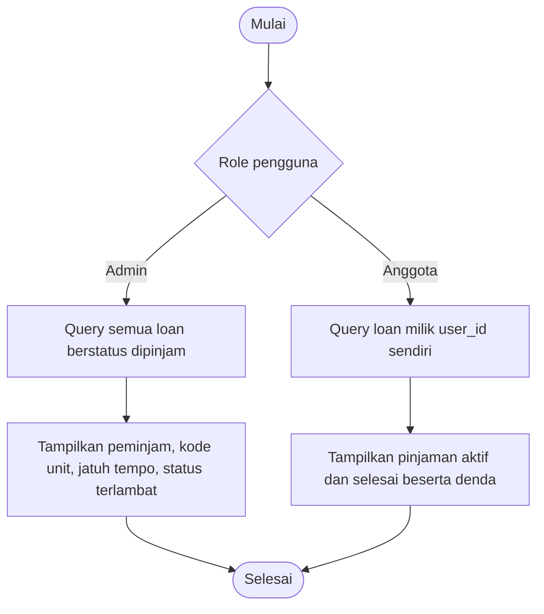
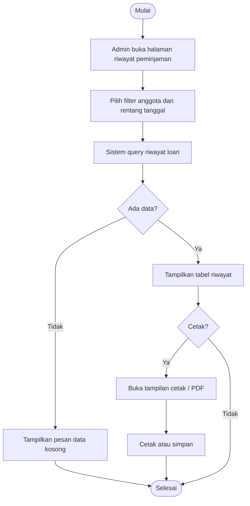
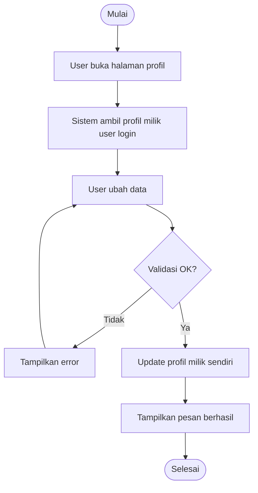
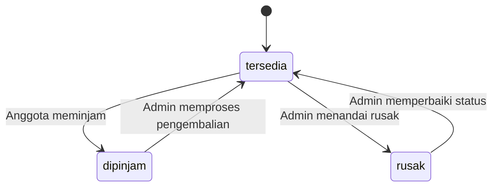

# Flow Chart

## Sistem Peminjaman Robot Pacar

Dokumen ini berisi flow chart proses utama sistem. Dokumen terkait: [BRD](BRD.md), [ERD](ERD.md), [PRD](PRD.md).

---

## 1. Gambaran Umum Sistem

## 2. Registrasi dan Login

## 3. Pencarian Robot

## 4. Peminjaman Robot (Anggota)

## 5. Pengembalian Robot dan Perhitungan Denda (Admin)

## 6. Manajemen Data Master (Admin)

Berlaku untuk robot, unit robot, kategori, dan anggota.

## 7. Daftar Pinjaman

## 8. Riwayat dan Cetak (Admin)

## 9. Ubah Profil

## 10. Siklus Status Unit

