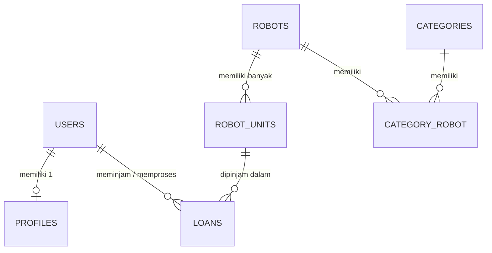

# 🤖 Sistem Peminjaman Robot Pacar

[](https://laravel.com)
[](https://php.net)
[](https://www.mysql.com)
[](https://tailwindcss.com)

Sistem Web Peminjaman Robot Pacar adalah platform terpusat untuk mengelola katalog, unit robot, keanggotaan, transaksi peminjaman, pengembalian, serta kalkulasi denda otomatis. Sistem ini dirancang untuk menghilangkan kesalahan pencatatan manual, mencegah stok yang tidak sinkron, dan mempermudah pelaporan.

---

## 👥 Informasi Tim & Kelompok

- **Nama Kelompok:** RoPar (Robot Pacar)
- **Anggota Team:**
  - Muhammad Ferdyansyah  - PM / 102022300141
  - Benedictus Chally Nugroho - Member / 102022300293
  - Rayhan Aliffio Wibowo - Member / 102022500103

---

## 📌 Dokumentasi Proyek

Dokumentasi lengkap pengembangan proyek ini dapat diakses pada berkas markdown berikut:

- 📄 [Business Requirements Document (BRD)](/Documentations/BRD.md)
- 🗄️ [Entity Relationship Diagram (ERD)](/Documentations/ERD.md)
- 🔀 [Flowchart / Process Flow](/Documentations/Flowchart.md)
- 📋 [Product Requirements Document (PRD)](/Documentations/PRD.md)

---

## ✨ Fitur Utama

### 👨‍💼 Fitur Admin
- **Dashboard Overview:** Ringkasan statistik unit dipinjam, total anggota, dan transaksi.
- **Manajemen Data Master (CRUD):**
  - CRUD Kategori Robot.
  - CRUD Model Robot (dukungan *multi-category* dan unggah foto).
  - CRUD Unit Robot (kode unit unik dan status unit).
  - CRUD Anggota & Profil.
- **Proses Pengembalian:** Memproses pengembalian unit secara langsung dengan perhitungan denda otomatis.
- **Laporan & Riwayat:** Filter riwayat peminjaman berdasarkan tanggal dan anggota, lengkap dengan fitur pencetakan (*print-friendly* / PDF).

### 👤 Fitur Anggota (Member)
- **Registrasi & Autentikasi Mandiri:** Pendaftaran akun anggota beserta data profil lengkap.
- **Katalog & Pencarian:** Pencarian robot interaktif berdasarkan nama model maupun kategori.
- **Peminjaman Mandiri:** Meminjam unit robot yang sedang tersedia.
- **Pinjaman Saya:** Memantau daftar unit yang sedang dipinjam, tanggal jatuh tempo, dan estimasi denda berjalan.
- **Manajemen Profil:** Mengubah data profil diri (1 user = 1 profil).

---

## 📐 Aturan Bisnis & Logika Sistem

| ID | Aturan Bisnis |
|---|---|
| **BR-01** | Pengguna wajib login untuk mengakses sistem (kecuali registrasi & login). |
| **BR-02** | Maksimal peminjaman aktif per anggota adalah **2 unit** secara bersamaan. |
| **BR-03** | Durasi batas peminjaman standar adalah **5 hari**. |
| **BR-04** | Keterlambatan dikenakan denda otomatis sebesar **Rp5.000 / hari**. |
| **BR-05** | Pengembalian unit hanya dapat diproses oleh Admin. |
| **BR-06** | Kode Unit Robot bersifat unik secara global di seluruh sistem. |
| **BR-07** | Data yang masih memiliki transaksi peminjaman aktif ditolak untuk dihapus (*Foreign Key Restrict*). |

### 🧮 Rumus Perhitungan Denda
```text
Jatuh Tempo     = Tanggal Pinjam + 5 Hari
Hari Terlambat  = MAX(0, Tanggal Kembali - Jatuh Tempo)
Denda           = Hari Terlambat × Rp 5.000
```

---

## 🛠️ Stack Teknologi

- **Backend Framework:** Laravel 13.x (PHP 8.3+)
- **Database:** MySQL 8.0
- **Frontend:** Blade Templates, Tailwind CSS 4, Alpine.js
- **Authentication:** Laravel session authentication
- **Export / Print:** Browser Native Print `@media print`

---

## 🗄️ Skema Database (ERD Preview)


> *Untuk skema dan kamus data rinci, silakan cek [ERD.md](/Documentations/ERD.md).*

---


## 🚀 Panduan Instalasi & Memulai (Getting Started)

### Prasyarat System
- PHP `>= 8.3`
- Composer `>= 2.x`
- MySQL / MariaDB
- Node.js & NPM

### Langkah-Langkah Instalasi

1. **Clone Repository**
   ```bash
   git clone https://github.com/Ferdyanshh/RoPar.git
   cd RoPar
   ```

2. **Instal Dependencies (PHP & JS)**
   ```bash
   composer install
   npm install && npm run build
   ```

3. **Konfigurasi Environment**
   Salin file `.env.example` menjadi `.env`:
   ```bash
   cp .env.example .env
   ```
   Atur koneksi database pada `.env`:
   ```env
   DB_CONNECTION=mysql
   DB_HOST=127.0.0.1
   DB_PORT=3306
   DB_DATABASE=robot_pacar_db
   DB_USERNAME=root
   DB_PASSWORD=
   ```

4. **Generate Application Key & Storage Link**
   ```bash
   php artisan key:generate
   php artisan storage:link
   ```

5. **Jalankan Migrasi & Seeder Database**
   ```bash
   php artisan migrate --seed
   ```

6. **Jalankan Server Lokal**
   ```bash
   php artisan serve
   ```
   Akses aplikasi di browser pada alamat: `http://127.0.0.1:8000`

---

## 🔑 Kredensial Default (Seeder)

Gunakan akun awal berikut untuk keperluan pengujian (UAT) setelah menjalankan `php artisan db:seed`:

| Role | Email | Password | Akses Utama |
|---|---|---|---|
| **Admin** | `admin@robotpacar.test` | `password` | Kelola master data, pengembalian, cetak laporan |
| **Anggota** | `member@robotpacar.test` | `password` | Cari robot, buat peminjaman, lihat denda |

---

## 🧪 Pengujian (UAT Scenarios)

Jalankan automated test dengan `php artisan test`. Skenario UAT manual perlu dicatat terpisah setelah diuji melalui aplikasi:
- Anggota tidak bisa meminjam lebih dari 2 unit sekaligus.
- Perhitungan denda tepat (Rp0 untuk <= 5 hari, Rp15.000 untuk keterlambatan 3 hari).
- Anggota yang mengakses rute Admin mendapat `403 Forbidden`.
- Kode unit harus unik dan kategori yang masih digunakan robot tidak dapat dihapus.

---

## 📄 Lisensi

Proyek ini dikembangkan di bawah lisensi [MIT License](https://opensource.org/license/mit).
